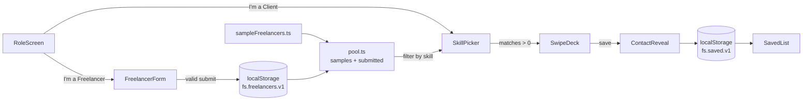

# Freelancer Swipe — Technical Spec

## How This Works, In Plain Language
Freelancer Swipe is a **website that runs entirely in the browser**. There is no server and no database yet.

- **The sample pool** is a list of 15 pre-made freelancer profiles written directly into the code. Every visitor gets them, so the deck is never empty.
- **The browser's local storage** (`localStorage`, a small notebook the browser keeps for one site) holds two things: freelancer profiles submitted through the form on this browser, and the client's Saved list. Both survive closing and reopening the browser on the same device.
- **The pool** the client swipes through = sample profiles + profiles submitted on this browser. That's why a freelancer who signs up shows up for a client only when both use the same browser. This is a conscious limit, fine for the demo video, and goes away when the shared SQL Server database is added later.
- **The screens** (role picker, freelancer form, skill picker, swipe deck, contact reveal, Saved list) are React components. The app shows one screen at a time.
- **The swipe** is hand-written: the card follows your finger or mouse, tilts a little, and flies off when dragged far enough. The ✕ / ↶ / ✓ buttons do the same thing without dragging.
- **Publishing:** every push to GitHub runs a GitHub Actions workflow that builds the site and puts it on GitHub Pages, a free public link.

Why this shape: the kernel is the *client-side experience* (one card at a time, judge by best image, save → contact now). None of that needs a server, so skipping one keeps the build small. The data is shaped so it can move to a real database later without changing the screens.

## The Core Journey Through the System
PRD ref: `prd.md > The Core Journey`.



**Freelancer side**
1. The freelancer taps **I'm a Freelancer** → `App` switches to `FreelancerForm`.
2. They fill the fields; skills are chips from the starter list plus a "type a skill" input.
3. Each field is checked when the user leaves it, and again on Submit by `validateFreelancer`. If anything is missing or malformed it's highlighted and nothing is saved. If all are present, `storage.addFreelancer` appends the profile to `fs.freelancers.v1` and a confirmation shows.
4. Next time anyone on this browser picks one of those skills as a client, `pool.ts` includes the new profile.

**Client side**
1. The client taps **I'm a Client** → `SkillPicker`. It lists starter skills plus any custom skills that submitted freelancers typed.
2. They tap one skill (or type one and press Find). `pool.findBySkill` returns freelancers whose skills match, ignoring case and extra spaces.
3. No matches → a toast says "No freelancers have '<skill>' yet". They stay on the picker to choose again.
4. Matches → `SwipeDeck` shows them one card at a time (`FreelancerCard`): big image, name, location, skill chips, and the video link.
5. Drag left / ✕ → skip (the card's index goes onto the back-history). ↶ → go back to the most recently skipped card. Drag right / ✓ → save.
6. Save → `storage.saveId` adds the freelancer's id to `fs.saved.v1` and `ContactReveal` opens with their contact info. "Keep browsing" closes it and moves to the next card.
7. After the last card the deck wraps to the first. Already-saved freelancers show a small "Saved" badge.
8. The Saved button (top of the deck) opens `SavedList`, which reads `fs.saved.v1` and shows each saved freelancer with name, image, and contact info.

## Stack
| Piece | Choice | Why (learner-agreed) | Docs |
|---|---|---|---|
| Build tool | **Vite** (`npm create vite@latest`, `react-ts` template) | Fast setup; builds static files that go straight onto GitHub Pages. Tradeoff accepted: needs Node and a build step. | https://vite.dev/guide/ |
| UI | **React** + **TypeScript** | Fits "one screen, one card at a time" better than plain HTML/JS. | https://react.dev/learn · https://www.typescriptlang.org/docs/ |
| Styling | **Tailwind CSS v4** via `@tailwindcss/vite` | Same approach as the ScratchCard reference (tokens in `@theme`). | https://tailwindcss.com/docs/installation/using-vite |
| Icons | **lucide-react** | Same icon set as the reference (✕, ✓, ↶, bookmark, etc.). | https://lucide.dev/guide/packages/lucide-react |
| Swipe | **Hand-written pointer events**, no library | No extra dependency; full control over ↶ (back). Tradeoff accepted: less springy than an animation library. | https://developer.mozilla.org/en-US/docs/Web/API/Pointer_events |
| Storage | **`localStorage`** | Learner choice: frontend only for now, SQL Server later. | https://developer.mozilla.org/en-US/docs/Web/API/Window/localStorage |
| Logic tests | **Vitest** (agent recommendation, implementation detail) | Fast checks of the pure logic (deck, pool, storage, validation) at each build step. | https://vitest.dev/guide/ |
| Hosting | **GitHub Pages via GitHub Actions** | Learner choice: free public link, deploys on every push. | https://docs.github.com/en/pages/getting-started-with-github-pages/using-custom-workflows-with-github-pages |

**Unverified (no version lookup done while planning):** use whatever versions `npm create vite@latest` and `npm install` give at build time. Early in the build, check: (1) the Vite React-TS template still scaffolds as expected; (2) Tailwind v4's Vite plugin setup matches the linked page; (3) the current major versions of `actions/configure-pages`, `actions/upload-pages-artifact`, and `actions/deploy-pages`.

## Where It Runs and How Someone Tries It
- **Runtime:** any modern browser, mobile-first layout (also usable on desktop with a mouse).
- **Requirements:** Node.js 20+ and npm. No API keys, no accounts.
- **Run locally:**
  ```
  npm install
  npm run dev        # open the URL Vite prints, e.g. http://localhost:5173
  npm test           # Vitest logic tests
  npm run build      # production build into dist/
  ```
- **Deploy (optional, chosen):** `.github/workflows/deploy.yml` runs on push to `main`: checkout → setup Node → `npm ci` → `npm run build` → upload `dist/` → deploy to Pages. One-time setup: repo **Settings → Pages → Source: GitHub Actions**. `vite.config.ts` uses `base: './'` so the site works under `https://<user>.github.io/<repo>/` whatever the repo is named.
- **Sharing links:** public repo https://github.com/KelvinTrinhSG/Freelancer-Marketplace · live app https://kelvintrinhsg.github.io/Freelancer-Marketplace/ · demo video: _not recorded yet_.
- **Note (historical):** the project folder was not a git repo at planning time. `5-build` initializes git, and a public GitHub repo is needed for deploy and submission.
- **Demo recording (required for submission):** in one browser, (1) role screen → I'm a Freelancer → submit a profile with a custom skill; (2) back → I'm a Client → pick that skill → their card appears; (3) pick a common skill, swipe a few, use ↶, save one → contact reveal; (4) open Saved; (5) reload the page → Saved is still there. Also show a no-match skill.

## Look and Feel
Carries forward `prd.md > Look and Feel` (updated during this spec to the ScratchCard reference, https://github.com/Kali-Decoder/ScratchCard, `scratch-your-card/app/globals.css`), plus `scope.md > Inspiration & Identity` (visual-first, fast, one card at a time).

- **Palette (Tailwind `@theme` tokens in `src/index.css`):** `background #000000`, `foreground #ffffff`, `accent #876dff` (purple), `card #121212`, `card-border #262626`, `muted #a1a1aa`. Skip = red-500, save = emerald-500, for the action buttons only.
- **Typography:** **JetBrains Mono** everywhere (Google Fonts link in `index.html`, fallback `monospace`). Headlines bold and large, using a purple text gradient (`bg-gradient-to-r from-accent to-purple-400 bg-clip-text text-transparent`).
- **Surfaces:** cards `rounded-2xl border border-card-border bg-card`. A soft purple glow behind the top of the page (`bg-accent/5 blur-[120px]`). Secondary text `text-muted`.
- **Buttons:** primary actions are solid purple `rounded-lg`. **Exception, the role screen:** two large fully rounded **pill** buttons (I'm a Client = solid purple; I'm a Freelancer = black with purple border) to keep the Tinder entry feel.
- **Motion:** `fade-in` on screen change, `slide-in-from-right` for toasts, card tilt/fly-out on swipe. Toasts use the reference's sharp-corner card style.
- **The swipe card:** the work image fills the top ~60% of the card uncropped (`object-contain`) over a blurred copy of itself, so wide screenshots stay readable. Name (with a round portrait avatar when there is one), location, skills and links sit in a dark gradient overlay at the bottom. Text is secondary to the image.
- **Copy tone:** short, direct, English. Sample profiles carry a small "Sample" tag.

## Components

### App (screen switcher)
Holds `screen` state: `role | form | picker | deck | saved`, plus the chosen skill. Renders one screen at a time with the shared glow background. No router library; each screen has an explicit back/home control. The browser back button and refresh return to the role screen (accepted for the POC).
PRD ref: `prd.md > Screens and Layout`.

### RoleScreen
App name, a plain one-line pitch that says what it does and who it's for ("Hire freelancers for small, fast jobs…"), a line for freelancers, and two pill buttons → `form` or `picker`. UI copy uses "save" for the positive action everywhere (not "tick" or "click") so it reads the same on touch and desktop and translates cleanly.
PRD ref: `prd.md > Role Selection`.

### FreelancerForm
Fields: display name, city (free text) + country (`<select>` from `data/countries.ts`, stored together as "City, Country"), skills (`SkillChips`, multi-select + custom input), best-project image link with a live preview thumbnail, video link (YouTube/TikTok, optional), portfolio link (any site, optional), contact info (free-text textarea, e.g. "Email: … / Zalo: … / Phone: …"). Each field is validated on blur and everything again on Submit. Missing or invalid fields are outlined red with a message, and nothing is saved. Inputs have `maxLength` caps. Valid → `storage.addFreelancer`, then a confirmation panel with "Add another" and "Go to client view".
PRD ref: `prd.md > Freelancer Profile Form`.

### SkillChips (shared)
Selectable chips plus a text input with "Add". Multi-select (check icon) in the form; single-select in the picker, where chips render as a radio group with a radio dot. A custom skill is trimmed and added as a chip. Duplicates (case-insensitive) are ignored.
PRD ref: `prd.md > Freelancer Profile Form`, `prd.md > Skill Picker`.

### SkillPicker
Shows `pool.allSkills()` (starter list + custom skills from submitted profiles) as single-select chips, plus a typed-skill input and a Find button. On choose: `pool.findBySkill`. Empty result → toast with an "Add yourself" action, stay. Otherwise the chosen chip stays highlighted with "Showing N freelancers for X…" for ~450 ms, then go to `deck`.
PRD ref: `prd.md > Skill Picker`, `prd.md > States and Boundaries` (no match).

### SwipeDeck
Owns the deck state through `deck.ts` (`{ cards, index, skippedHistory }`). Renders the current `FreelancerCard` with the `useSwipe` hook, buttons ✕ / ↶ / ✓ (↶ disabled when history is empty), a header showing the chosen skill and "N of M freelancers", a hint line explaining ✓ / ✕ / ↶, and a Saved button with a count. Keyboard on desktop: → save, ← skip, Z or Backspace brings back the last skip.
PRD ref: `prd.md > Swipe Deck`.

### FreelancerCard
Work image (`onError` → placeholder: purple gradient with the freelancer's initials), avatar if present, name, location, skill chips, "Sample" tag if applicable, "Saved" badge if already saved. The video link ("Watch on YouTube/TikTok", or "Listen…" for audio skills) and the portfolio link are real `<a target="_blank" rel="noopener noreferrer">` links that and stops pointer propagation so tapping it doesn't start a drag.
PRD ref: `prd.md > Swipe Deck`.

### useSwipe (hook)
Pointer events on the card: `pointerdown` captures the pointer, `pointermove` sets `translateX(dx) rotate(dx/20 deg)`, `pointerup` decides. If `|dx| >` 30% of card width (min 100px), the card animates off-screen (~200ms) and calls `onSwipe('left' | 'right')`. Otherwise it snaps back. The card uses `touch-action: pan-y` so vertical scrolling still works. Buttons call the same fly-out animation programmatically.
PRD ref: `prd.md > Swipe Deck`.

### ContactReveal
Overlay on the deck after a save: avatar (or image) thumb, name, contact info (whitespace preserved), "Keep browsing" (closes and advances) and "View saved".
PRD ref: `prd.md > Save and Contact Reveal`.

### SavedList
Reads saved ids, resolves them against the pool (unknown ids skipped), newest first. Each row: avatar (or image) thumb, name, contact info. Empty → "No one saved yet. Browse freelancers to start." with a button back to the picker.
PRD ref: `prd.md > Saved List`, `prd.md > States and Boundaries`.

### Toast
Small presentational piece in the reference style. Used for no-match (with an optional action button) and storage warnings.

### Logic modules (`src/lib`)
- **`storage.ts`**: `loadFreelancers / addFreelancer / loadSavedIds / saveId`. Every read is wrapped in try/catch with a shape check; bad or missing data → empty array.
- **`pool.ts`**: `getPool()` = samples + submitted; `normalizeSkill(s)` = trim, collapse spaces, lowercase; `findBySkill(skill)`; `allSkills()` = starter skills ∪ submitted skills, deduped by normalized form, keeping the first display spelling.
- **`deck.ts`**: pure functions `skip`, `back`, `advance` (after save) with wrap-around: `index = (index + 1) % cards.length`. `skip` pushes the current index onto `skippedHistory`; `back` pops it and sets `index`. A one-card deck keeps showing that card.
- **`validate.ts`**: `validateFreelancer(input, { imageLoads })` → `{ ok, errors: Record<field, message> }`. Links must be real web addresses: `http(s)://` plus a dotted public hostname, no spaces (rejects `http:foo`, `http://abc`, `localhost`). Video must be on YouTube or TikTok. The image link must end in an image extension or have loaded in the preview. Length caps: name/city 60, contact 300, skill 40. `storage.ts` also drops stored links that fail `isHttpUrl`. React escapes all rendered text, so profile text can't inject markup.

## Data Model
```ts
type Freelancer = {
  id: string;          // sample: "s-01".."s-15"; submitted: crypto.randomUUID()
  name: string;
  location: string;    // optional in the form; shown if present
  skills: string[];    // display spelling; matched via normalizeSkill
  videoUrl?: string;   // YouTube/TikTok, optional
  portfolioUrl?: string; // any public portfolio page, optional
  avatarUrl?: string;  // portrait, sample profiles only
  imageUrl: string;    // best project image link
  contact: string;     // free text, may contain several methods
  isSample: boolean;
  createdAt: string;   // ISO date
};
```

| Data | Lives in | Updated when | After leaving and coming back |
|---|---|---|---|
| Sample profiles (15) | `src/data/sampleFreelancers.ts` (code) | Never at runtime | Always there |
| Starter skills | `src/data/skills.ts` (code) | Never at runtime | Always there |
| Submitted profiles | `localStorage["fs.freelancers.v1"]`, `Freelancer[]` | Valid form submit | Still there on this browser |
| Saved list | `localStorage["fs.saved.v1"]`, `{ id, savedAt }[]` | Save (no duplicates) | Still there on this browser |
| Current screen, chosen skill, deck position, back-history | React state | Navigation / swipes | Reset (back to role screen) |

The `.v1` suffix lets a later version change the shape safely. When the SQL Server backend arrives, `storage.ts` is the single file to swap for API calls.

**Starter skills (proposed by the build, per `prd.md > Open Questions`):** Short video editing, Game testing, Logo design, Social media content, Voice-over, Subtitles & translation, Illustration, Photo editing, Landing page design, Music & sound effects.
**Sample profiles:** 10, with every starter skill covered by at least 2 profiles. Each profile has a work-sample image for its first skill (`public/samples/work-<n>.jpg`, shown uncropped as the card's main image over a blurred fill) and a portrait (`public/samples/<n>.jpg`, shown as a round avatar next to the name and as the thumbnail in Saved and the contact popup). Names are matched to each portrait. Submitted profiles have no avatar. Video links are optional per profile. All are tagged "Sample".

## File Structure
```
Freelancer Marketplace/
├── .github/workflows/
│   └── deploy.yml            # build + deploy to GitHub Pages on push to main
├── public/
│   ├── favicon.svg
│   └── samples/              # sample portraits (1–10.jpg) and work samples (work-1–10.jpg)
├── src/
│   ├── main.tsx              # React entry
│   ├── App.tsx               # screen switcher, shared background
│   ├── index.css             # Tailwind import, @theme tokens, keyframes
│   ├── types.ts              # Freelancer, SavedEntry, Screen
│   ├── data/
│   │   ├── skills.ts         # starter skill list
│   │   ├── countries.ts      # country list for the form
│   │   └── sampleFreelancers.ts  # 10 labeled sample profiles
│   ├── lib/
│   │   ├── storage.ts        # localStorage read/write with safe parsing
│   │   ├── pool.ts           # merge samples + submitted, skill matching
│   │   ├── deck.ts           # skip / back / advance / wrap (pure)
│   │   ├── validate.ts       # freelancer form validation
│   │   └── *.test.ts         # Vitest tests for the four modules above
│   ├── hooks/
│   │   └── useSwipe.ts       # pointer-event drag, tilt, fly-out
│   ├── components/
│   │   ├── SkillChips.tsx
│   │   ├── FreelancerCard.tsx
│   │   ├── ContactReveal.tsx
│   │   └── Toast.tsx
│   └── screens/
│       ├── RoleScreen.tsx
│       ├── FreelancerForm.tsx
│       ├── SkillPicker.tsx
│       ├── SwipeDeck.tsx
│       └── SavedList.tsx
├── index.html                # loads JetBrains Mono, mounts #root
├── vite.config.ts            # react + tailwind plugins, base './', vitest config
├── tsconfig.json
├── package.json
├── README.md                 # what it is, how to run, demo steps, known limits
└── devpost/                  # Devpost learning workspace
```

## External Services and Dependencies
- **GitHub Pages + GitHub Actions:** free for public repos. Workflow uses `actions/checkout`, `actions/setup-node`, `actions/configure-pages`, `actions/upload-pages-artifact` (path `dist`), `actions/deploy-pages`. Needs `permissions: pages: write, id-token: write`. No secrets. Docs: https://docs.github.com/en/pages/getting-started-with-github-pages/using-custom-workflows-with-github-pages
- **Google Fonts (JetBrains Mono):** `<link href="https://fonts.googleapis.com/css2?family=JetBrains+Mono:wght@400;600;700;800&display=swap" rel="stylesheet">`. No key. Offline → system monospace.
- **YouTube / TikTok:** links only, opened in a new tab. No API calls.

## Important Failure Modes
- **Broken or slow image link** (common with pasted links) → card shows a purple gradient placeholder with initials. The card stays usable.
- **localStorage unavailable or corrupted** (private mode, manual edits) → reads return empty, the app runs with sample profiles only, and a toast says "Can't save on this browser". Writes are wrapped in try/catch.
- **Blank page on GitHub Pages** (wrong asset paths) → prevented with `base: './'`. Verified by opening the deployed URL after the first deploy.
- **Tapping the video link starts a drag** → the link stops pointer propagation. Checked manually on a touch device or emulation.

## What Was Simplified and Why
- **localStorage instead of SQL Server** (learner choice): the kernel is the client experience, which needs no server. The fuller version needs an API, hosting for it, and a database. `storage.ts` is the seam for that later.
- **Pool shared only within one browser** (learner choice): a submitted profile reaches clients on the same browser only. Enough to show the whole loop in one demo video.
- **Image by pasted link** (from the PRD): no upload or storage service.
- **Sample data is clearly labeled:** 10 "Sample" profiles with stock portraits, stock work images and public YouTube clips. The swiping, matching, saving, and saving are all real.
- **No router:** screens switch through React state. Refresh returns to the role screen. Deep links aren't needed for the demo.
- **Hand-written swipe instead of an animation library** (learner agreed): less springy, no dependency.

## Decisions and Open Issues
**Learner decisions**
- Frontend only, `localStorage`; SQL Server later.
- One pool = sample list + submissions on the same browser; the cross-device limit is accepted.
- Deploy with GitHub Actions → GitHub Pages.
- Vite + React + TypeScript.
- Visual style from the ScratchCard repo, replacing the Tinder gradient in the PRD (PRD updated).
- Accepted agent recommendations: purple pill buttons on the role screen, hand-written pointer-event swipe.

**Implementation details derived by the agent** (changeable without re-planning): Tailwind v4 + lucide-react (match the reference), Vitest for the logic modules, the `fs.*.v1` storage keys, the swipe threshold (30% / 100px), the starter skill list, bundled sample photos, contact info as one free-text field, ↶ only undoes skips (not saves), saved freelancers show a "Saved" badge when the deck loops.

**Learner uncertainty:** asked; the learner said there was none. Nothing to record or investigate.

**Verification approach for `5-build`:** each step ends with `npm test` (logic) and/or a manual check in `npm run dev` against the matching PRD checkbox. The deploy step ends with opening the live Pages URL.

**Open:** none blocking. The GitHub repo name and account are needed at the deploy step; `base: './'` means the name doesn't affect the code.

## Changes After Judge Feedback (Oct 26)
The sections above already reflect these changes. Summary: "save" wording, marquee removed, single-choice picker with a short transition, keyboard shortcuts, stricter link validation with a live image preview, display name + city/country, optional portfolio link, avatar + uncropped work image on the card, a visible `:focus-visible` outline, and 10 skill-matched sample profiles. Reasons and the remaining items are in `judge-feedback-plan.md`.
